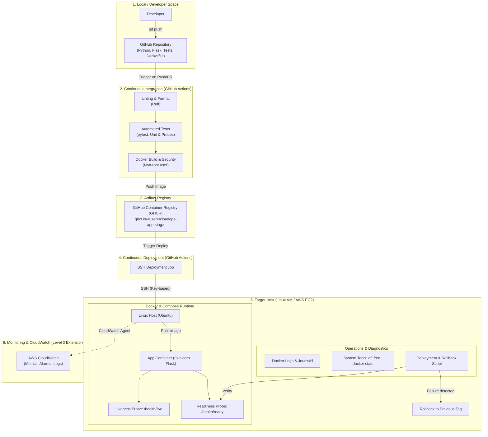

# Kiến trúc Hệ thống — CloudOps Lab

Tài liệu này mô tả kiến trúc tổng thể, vai trò của từng thành phần, luồng phát hành và nguyên tắc vận hành của hệ thống **CloudOps Lab — Automated Deployment, Monitoring & Incident Response**.

---

## 1. Sơ đồ Kiến trúc Tổng thể

---

## 2. Chi tiết các Thành phần và Vai trò

| Thành phần | Công nghệ | Vai trò & Trách nhiệm |
| :--- | :--- | :--- |
| **Application Layer** | Python 3.11+, Flask | Dịch vụ web tối giản, cung cấp API mẫu và 2 endpoint cốt lõi phục vụ vận hành: `/health/live` và `/health/ready`. |
| **WSGI Server** | Gunicorn | Quản lý process workers, phục vụ concurrency, quản lý request timeouts và xử lý graceful shutdown (thay vì development server `flask run`). |
| **Code Quality & Test** | Ruff, pytest | `Ruff` kiểm tra linting và formatting nhanh; `pytest` kiểm tra logic ứng dụng, HTTP status codes và cấu trúc payload của health checks. |
| **Containerization** | Docker | Đóng gói ứng dụng trong môi trường cách ly, cấu hình user không đặc quyền (`non-root`), thiết lập `HEALTHCHECK` tích hợp. |
| **Host Orchestration** | Docker Compose | Khai báo cấu trúc triển khai (`compose.yaml`): port mapping, restart policy (`unless-stopped`), logging limits, và environment variables. |
| **CI/CD Automation** | GitHub Actions | Tự động hóa quy trình lint $\rightarrow$ test $\rightarrow$ build $\rightarrow$ push GHCR $\rightarrow$ trigger deploy qua SSH an toàn. |
| **Artifact Store** | GHCR | Lưu trữ và đánh version (semantic tag & git commit sha) cho các image, đảm bảo tính bất biến (immutability) của bản phát hành. |
| **Target Host** | Ubuntu Linux VM / EC2 | Máy chủ chạy ứng dụng thực tế. Cấu hình bảo mật SSH (chỉ dùng key, tắt password), firewall (UFW/Security Group), non-root deploy user. |
| **Release Management** | `deploy.sh` (Bash) | Script thực hiện pull image mới, chạy health probe verification. Nếu probe trả mã lỗi hoặc timeout, tự động kích hoạt **rollback** về image tag trước đó. |
| **Observability** | Linux CLI $\rightarrow$ Script $\rightarrow$ CloudWatch | Thu thập logs tiến trình (`docker logs`), kiểm tra tài nguyên (`docker stats`, `free`, `df`), cảnh báo sự cố. |

---

## 3. Luồng Vận hành Chuẩn (Release Lifecycle)

1. **Giai đoạn Tích hợp (CI)**:
   - Developer push code lên branch `main` hoặc tạo Pull Request.
   - GitHub Actions chạy Ruff kiểm tra syntax/style.
   - Chạy Pytest xác minh hành vi ứng dụng và tính toàn vẹn của health probes.
   - Build Docker image với nhãn tag `sha-<commit_id>` và `latest`.
   - Push image lên GHCR.

2. **Giai đoạn Triển khai (CD & Verification)**:
   - Pipeline CD kết nối tới server qua SSH bằng Private Key (lưu trong GitHub Secrets).
   - Server ghi nhận tag hiện tại đang chạy thành công (`CURRENT_TAG`).
   - Cập nhật biến môi trường `IMAGE_TAG` sang tag mới và thực thi `docker compose up -d`.
   - Script chạy vòng lặp kiểm tra (polling probe) vào `http://127.0.0.1:8000/health/ready`.
   - **Kịch bản Thành công**: Health check trả về `200 OK` trong thời gian quy định $\rightarrow$ Ghi log deployment thành công, kết thúc pipeline.
   - **Kịch bản Thất bại**: Health check timeout hoặc trả về `5xx` $\rightarrow$ Script lập tức gọi lệnh rollback với `CURRENT_TAG`, khởi động lại bản cũ và cảnh báo lỗi.

---

## 4. Ranh giới Phạm vi (Scope Boundaries)

### Thuộc phạm vi (In-Scope):
* Đóng gói chuẩn production với WSGI, container non-root.
* Tự động hóa hoàn toàn từ commit code tới server chạy thực tế.
* Quy trình deployment có kiểm tra tính sẵn sàng và cơ chế rollback tự động.
* Sử dụng các công cụ chuẩn của hệ điều hành Linux để điều tra và xử lý sự cố.

### Nằm ngoài phạm vi (Out-of-Scope) — Tránh làm phức tạp hóa:
* **Không dùng Kubernetes**: Một container trên một server đơn lẻ là đủ để học sâu về Linux OS, Docker internals, và networking. K8s sẽ che giấu các vấn đề cấp thấp của OS.
* **Không dùng Database phức tạp**: Tránh gánh nặng quản lý state, migrations và kết nối DB trong giai đoạn đầu. Mục tiêu là tập trung vào quy trình release và incident handling.
* **Không dùng công cụ giám sát nặng (Prometheus/Grafana stack)** ở giai đoạn đầu: Ưu tiên làm chủ lệnh Linux (`journalctl`, `ps`, `top/htop`, `ss`, `curl`) trước khi dùng dashboard.
